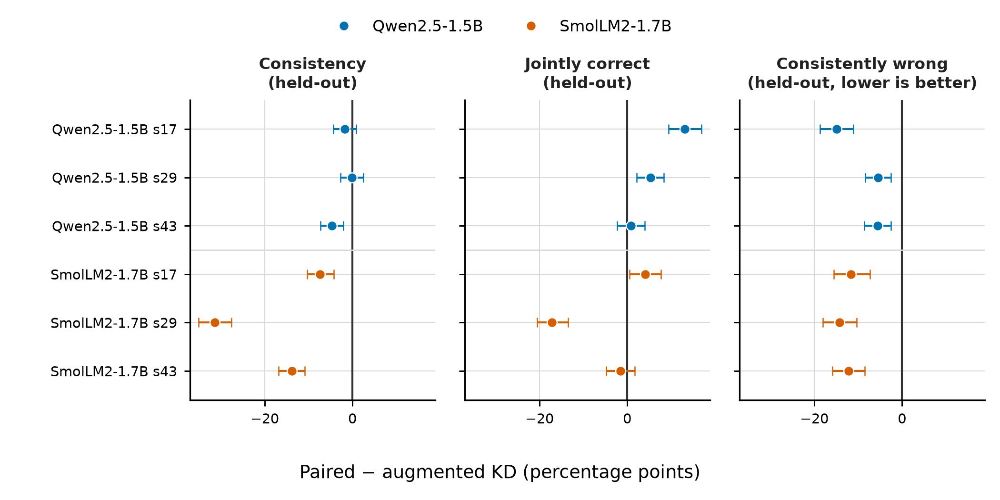
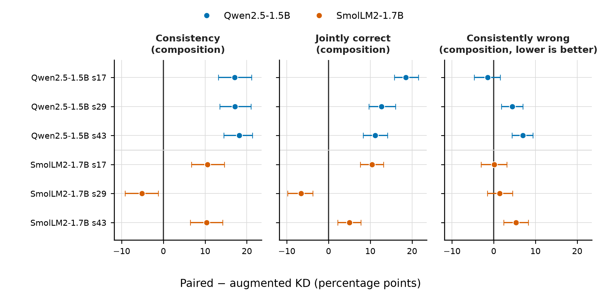
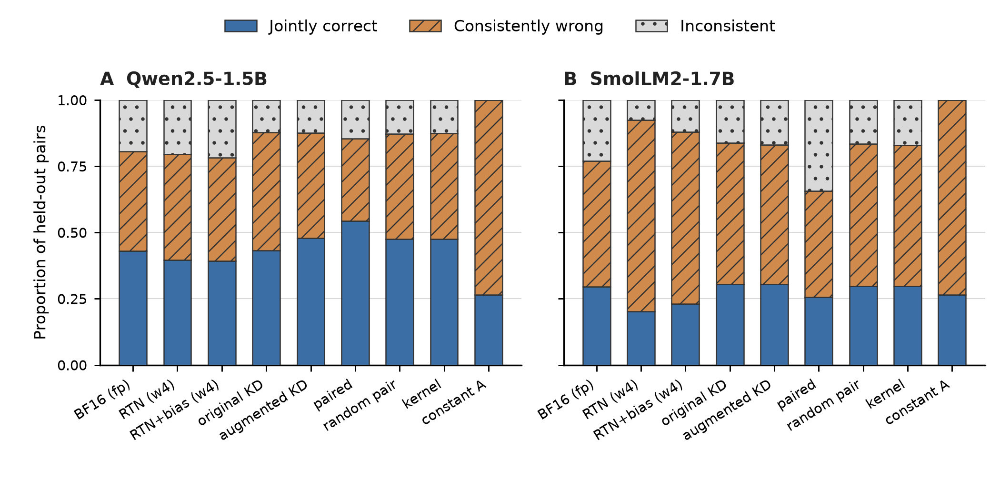

# Independent evaluation

Paired calibration reduces held-out-single consistency for both models.
Qwen gains joint correctness and composition consistency, but Smol's effects
change sign across fit seeds. Both models move away from the full-precision
teacher. The comparison is against augmented KD with
the same input rows, order, trainable scales and 96 optimizer updates.

## Evaluation boundary

Each condition evaluates 768 final bases and 384 larger-structure bases:
1,152 distinct problems, rendered into 6,144 inputs. Variants of a problem
stay together. The released report separates both splits and all three task
families; pooled results below weight every base equally.

Entity renaming and fact order are absent from gradient updates but present
in development selection. Compositions are absent from both fitting and
selection. Thus the composition endpoint is a separate secondary transfer
test. It is not evidence for primitive transformation families unseen to the
complete selection procedure.

Consistency C compares canonical option identities. Joint correctness J
requires both the original and transformed input to be correct. Consistently
wrong agreement W requires agreement on a wrong canonical option; C = J + W.
These rates first average variants within a base and then average bases.
Teacher fidelity compares the fitted model and BF16 on the same input.
Fit seeds are reported separately, not treated as extra evaluation problems.

## Qwen2.5-1.5B

On the pooled final and structural bases, the paired loss raises joint
correctness but lowers total consistency on held-out single transformations.
The seed-43 joint-correctness interval spans zero. Wrong agreement falls at
every seed. Table 1 uses paired minus same-seed augmented KD; all values are
percentage points. Intervals use 1,000 paired whole-base bootstrap resamples
at seed 4108 and are unadjusted, conditional on each fitted model.

Table 1. Qwen contrasts on held-out single transformations, 1,152 bases

| Fit seed | Delta C | Delta J [95% interval] | Delta W | Delta teacher fidelity |
|--:|--:|--:|--:|--:|
| 17 | -1.87 | +11.50 [8.55, 14.37] | -13.37 | -6.42 |
| 29 | -1.87 | +3.47 [0.82, 6.08] | -5.34 | -13.11 |
| 43 | -4.51 | +2.04 [-0.52, 4.77] | -6.55 | -9.29 |

For fully withheld compositions, consistency rises by 14.71–20.62 points and
joint correctness by 10.63–16.19 points across seeds; all six intervals lie
above zero. Wrong composition agreement rises by 4.08 and 9.42 points at
seeds 29 and 43, while seed 17 changes it by -0.17 points with an interval
spanning zero. Composition teacher fidelity falls by 3.39–12.63 points.
This is a mixed correctness/invariance tradeoff, rather than preservation of
the teacher's predictions.

The four-logit mean-drift correction does not account for the paired result.
On the final split, held-out joint correctness is 39.65% for W4 and 39.19%
after that correction, versus descriptive three-fit means of 47.96% for
augmented KD and 54.41% for paired calibration. The corresponding random-pair
and kernel-control means are both 47.48%. These are descriptive control
comparisons; their magnitudes are not paired-bootstrap intervals.

## SmolLM2-1.7B

The Qwen result does not transfer reliably. Table 2 uses the same pooled
support and estimator as Table 1. Every consistency interval lies below zero.
Joint correctness improves at seed 17, declines at seed 29, and has an
interval spanning zero at seed 43. All selected fits completed the fixed
96 updates with finite losses; final outcomes did not change the selected
strength or checkpoint.

Table 2. Smol contrasts on held-out single transformations, 1,152 bases

| Fit seed | Delta C | Delta J [95% interval] | Delta W | Delta teacher fidelity |
|--:|--:|--:|--:|--:|
| 17 | -8.77 | +4.25 [1.30, 7.12] | -13.02 | -25.95 |
| 29 | -31.94 | -15.62 [-18.36, -12.93] | -16.32 | -33.20 |
| 43 | -13.06 | -1.65 [-4.21, 0.74] | -11.41 | -12.72 |

For fully withheld compositions, consistency changes by +9.11, -5.25, and
+8.16 points at seeds 17/29/43. Joint correctness changes by +9.81
[7.20, 12.11], -5.64 [-8.12, -3.43], and +4.56 [2.30, 6.68] points.
The seed-29 effect is negative on both metrics, so a consistent transfer
benefit across fits is unsupported. Composition teacher fidelity falls by
17.71–38.15 points. Wrong composition agreement increases at seed 43 by
3.60 points [1.30, 6.03].

Uncalibrated W3 selects displayed A on 6,139/6,144 independent inputs
(99.92%). It is close to, but not identical with, the fixed displayed-A
control. The pilot's all-A observation applies to its separate 704 inputs.
On the 768-base final split, the four-logit correction raises W4 joint
correctness from 20.18% to 23.11%. Three-fit means are 30.51% for augmented
KD, 25.67% for paired calibration, 29.75% for random pairing and 29.77% for
the kernel control. Paired calibration therefore also trails these matched
controls on this descriptive final-split average. This comparison does not
have an additional pooled-across-seeds confidence interval.

## Figures and evidence

Figures 1–3 use only the 768-base final split, whereas Tables 1–2 above pool
the final and 384-base structural splits. The distinction is intentional;
all subgroup estimates remain in the saved reports.

Figure 1. Paired-minus-augmented effects on held-out single transformations.
Points are distinct fitted seeds; bars are conditional 95% paired-base
bootstrap intervals. Lower is better only for consistently wrong agreement.

Figure 2. Secondary effects on compositions withheld from fitting and selection.
The estimator and interval conventions match Figure 1.

Figure 3. Correct, wrong, and inconsistent outcomes. Rates average within
each base before averaging bases. Learned bars are descriptive three-fit
means; the untrained controls have one result. Hatching and dots distinguish
wrong agreement and disagreement from jointly correct answers.

The full numeric tables include original/transformed accuracy, consistency,
joint correctness, wrong agreement, composition outcomes and teacher fidelity:
[final split](../figures/final/table-final.csv) and
[structural holdout](../figures/final/table-structural.csv).
[Qwen](../results/final/qwen/) and [Smol](../results/final/smol/) include
raw compressed predictions, summaries, comparisons and inference manifests.
The scripts replay the saved predictions without loading model weights.

The results support measuring the tradeoffs separately. They do not support
adopting this paired scale recipe as a generally superior quantizer. Generic
consistency training remains a possible explanation for Qwen's improvements:
an unquantized scale-training control and stronger deployed PTQ comparisons
are absent. The four-logit diagnostic tests only that specific correction.

## Executed settings

Table 3. Common settings and evidence

| Item | Executed value | Evidence |
|:--|:--|:--|
| Models | Qwen2.5-1.5B-Instruct; SmolLM2-1.7B-Instruct; pinned revisions | Configs and run manifests |
| Quantization | Signed RTN W8/W4/W3, group 128; calibration W4; BF16 forward | Run manifests |
| Frozen parameters | Integer codes and pretrained weights, biases, head, embeddings, norms | Calibration implementation and fit manifests |
| Trainable deltas | Qwen 10,235,904; Smol 12,582,912 | Fit manifests |
| Training | AdamW lr 0.001; betas 0.9/0.999; weight decay 0; clip 1 | Fit manifests |
| Exposure | Four bases/eight prompts per update; 96 updates; 384 bases/768 prompts | Input and batch-order records |
| Fit seeds | 17, 29, 43 | Fit manifests |
| Strength search | 0.1, 1, 10; seed-17 development selection | Frozen selection JSON |
| Selected strengths | Qwen paired/random/kernel: 10/1/0.1; Smol: 10/0.1/10 | Frozen selections |
| Scoring | Official chat template, next-token A–D, batch 8, maximum 1,024 tokens without truncation | Configs/scorer |
| Runtime | Python 3.12, Torch 2.12.0+rocm7.14.0, Transformers 4.57.1, RX 9070 XT | environment.json |

See the [protocol](protocol.md), [calibration plan](calibration-plan.md), and
[reproduction guide](reproduce.md) for exact definitions, parameters and
commands. The [novelty audit](related-work.md) distinguishes this controlled
application from established consistency training and relational quantization.
