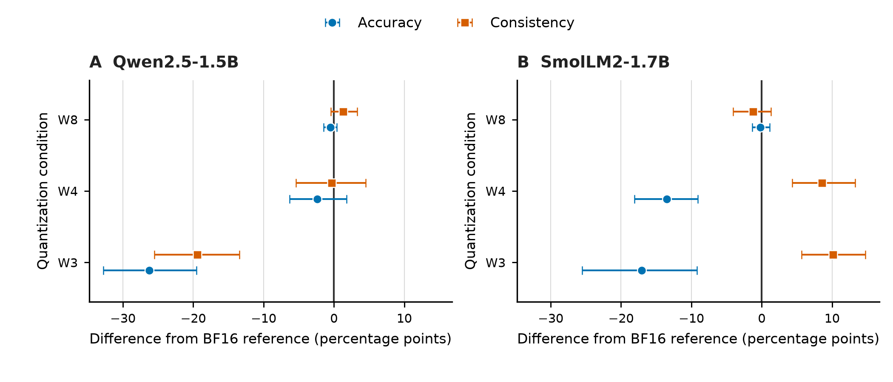
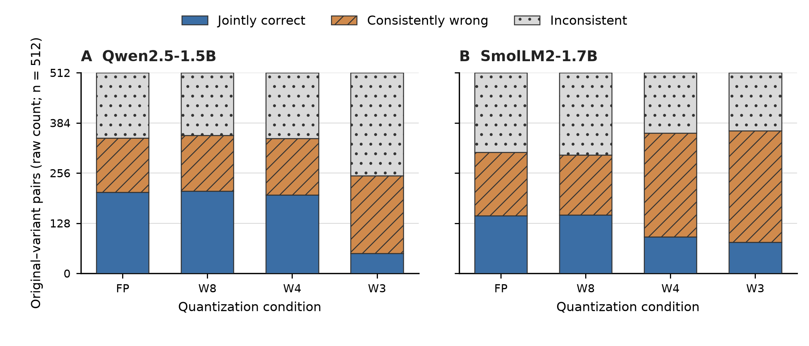

# Two-model quantization pilot

The pilot supports a matched calibration experiment, but does not establish
that quantization uniformly reduces consistency. Qwen W4 changed many pairs
in both directions with almost no net consistency change. Smol W4/W3 became
more consistent while losing accuracy. These results motivated the frozen
[calibration comparison](calibration-plan.md); they are exploratory evidence,
not the independent final evaluation.

## Design and execution

Each model evaluated the same 192 independently generated base problems:
64 arithmetic, 64 Boolean-assignment, and 64 directed-graph problems. The
704 rendered inputs comprise the original plus an option permutation and
entity renaming for every base, and independent-fact order for Boolean/graph
bases. There are 512 original-variant pairs. Executable oracles determine the
unique correct canonical option; displayed option indices are transported
back to canonical identities before agreement is calculated.

The reference uses BF16. RTN W8/W4/W3 applies symmetric signed grouped
quantization to transformer linear weights, excluding embeddings and output
head, with groups of 128 input columns. The weights are dequantized for BF16
arithmetic. These experiments make no packed-storage or inference-speed claim.
The primary endpoint is constrained next-token A-D scoring with the official
chat template, left padding, attention-derived positions, FP32 probabilities,
and argmax of the original option logits. Free generation was not evaluated.

The protocol was committed at `d2f70df`, with uniqueness and relational-control
amendments before model inference. The evaluated source was `431723b`; 30
offline tests passed directly. Independent checks corrected padding and BF16
probability-rounding errors before any pilot predictions were collected.
Both model runs completed all four conditions without an execution error.

## Results and decision

Table 1 reports equal-base-weighted means: correctness is first averaged over
each base's prompts, and consistency over its available original-variant pairs.
The two averages therefore need not equal a pooled prompt/pair micro-average.

Table 1. Accuracy and canonical consistency on the fixed pilot, percent

| Model | Weights | Accuracy | Consistency |
|:--|:--|--:|--:|
| Qwen2.5-1.5B | BF16 | 50.61 | 66.84 |
| Qwen2.5-1.5B | W8 | 50.13 | 68.14 |
| Qwen2.5-1.5B | W4 | 48.26 | 66.49 |
| Qwen2.5-1.5B | W3 | 24.35 | 47.40 |
| SmolLM2-1.7B | BF16 | 40.02 | 60.33 |
| SmolLM2-1.7B | W8 | 39.80 | 59.11 |
| SmolLM2-1.7B | W4 | 26.52 | 68.92 |
| SmolLM2-1.7B | W3 | 22.96 | 70.49 |

Figure 1 separates these directions and their uncertainty. Qwen W4 consistency
changed by -0.35 percentage points (95% base-bootstrap interval -5.38 to 4.51).
Nevertheless, it broke 64 previously consistent pairs and repaired 63.
Qwen W3 changed consistency by -19.44 points (-25.53 to -13.45), breaking
166 and repairing 70 pairs. W4 and W3 both meet the prospectively specified
calibration trigger of at least ten broken pairs. That trigger is a development
rule, not a test of statistical significance or a general degradation claim.

Figure 1. Paired differences from the BF16 reference on 192 pilot bases per
model. Circles show accuracy and squares canonical consistency, in percentage
points. Horizontal intervals are percentile 95% intervals from 1,000 paired
resamples of whole base problems, seed 4108. All variants stay with their
base. Panels share the same scale; these are pilot comparisons.

Figure 2 shows why more agreement alone is insufficient. In Smol, consistently
wrong pairs increased from 162 under BF16 to 265 under W4 and 285 under W3.
Under W3, constrained scoring selected displayed A for all 704 prompts.
Such a constant letter agrees under entity/fact-order transformations even
though its task accuracy is near chance; option permutation exposes some of
the mismatch. The final descriptive comparison includes a fixed displayed-A
control, selected before observing final model outcomes.

Figure 2. Raw outcomes of all 512 original-variant pairs per model. Solid blue
segments are jointly correct, hatched orange segments agree on a wrong
canonical option, and dotted gray segments disagree. These are descriptive
pair counts, not the equal-base-weighted rates in Table 1; no independence of
pairs or inferential interval is asserted by the stacks.

The results do not isolate a failure mechanism independent of pointwise
prediction changes: a pair can change agreement only if at least one member
changes its prediction. Nor do they establish that an invariance loss improves
reasoning. The next comparison keeps quantizer initialization, inputs, updates
and trainable parameters fixed, and tests jointly correct outcomes and teacher
fidelity alongside consistency on previously unused transformations.

## Reproduction and settings

The exact pilot inputs are in [data/pilot](../data/pilot). Curated predictions,
manifests and machine-readable summaries are in
[results/pilot](../results/pilot). Predictions are gzip-compressed; decompress
them into an ignored working directory before using the analysis CLI.
The [plot script](../scripts/plot_pilot.py) reads the saved analyses and exports
PDF/PNG plus the plotted numbers. Both exported PNGs were visually inspected
at their intended seven-inch width. The source model weights and private
implementation-session logs are not included.

Table 2. Executed pilot settings and verification sources

| Setting | Executed value | Source |
|:--|:--|:--|
| Qwen model revision | `989aa7980e4cf806f80c7fef2b1adb7bc71aa306` | `configs/pilot.json`, Qwen run manifest |
| Smol model revision | `31b70e2e869a7173562077fd711b654946d38674` | `configs/smol-pilot.json`, Smol run manifest |
| Pilot base seed/count | 3108; 64 bases per family | Data manifest |
| Prompt batch/context cap | 8; 1,024 tokens, no truncation | Config and shared scorer |
| Quantizer | Signed RTN; group 128; W8/W4/W3; BF16 arithmetic | Run manifests |
| Bootstrap | 1,000 base resamples; seed 4108 | Analysis JSON |
| Hardware | Radeon RX 9070 XT, approximately 16 GiB | Run manifests |
| Runtime | Python 3.12; torch 2.12.0+rocm7.14.0; transformers 4.57.1 | Run manifests |
| Scope | English procedural MCQ; two small instruction models | Inputs and pinned configs |

Prompt-specific option preferences, simple procedural tasks, the RTN baseline,
and constrained scoring limit generalization. Larger models, natural-language
benchmarks, free generation and optimized deployment kernels are outside the
evidence collected in this pilot.
